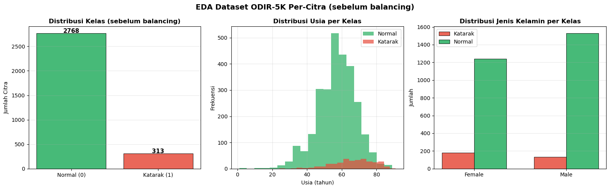
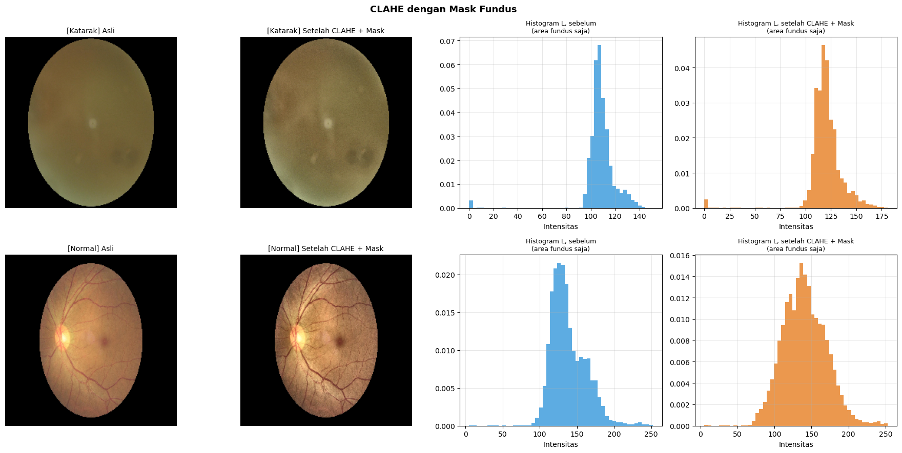
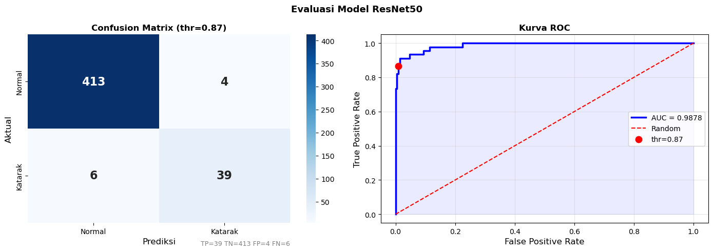
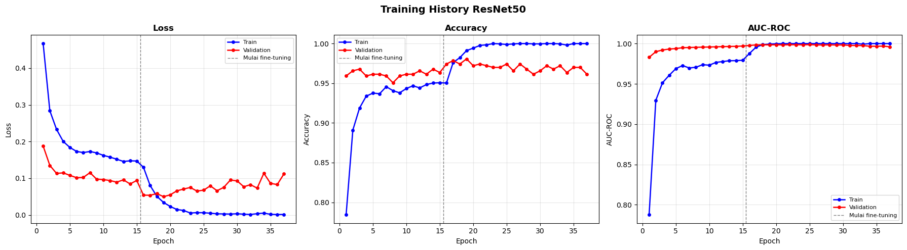
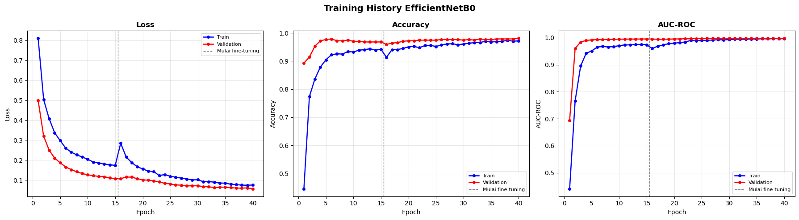
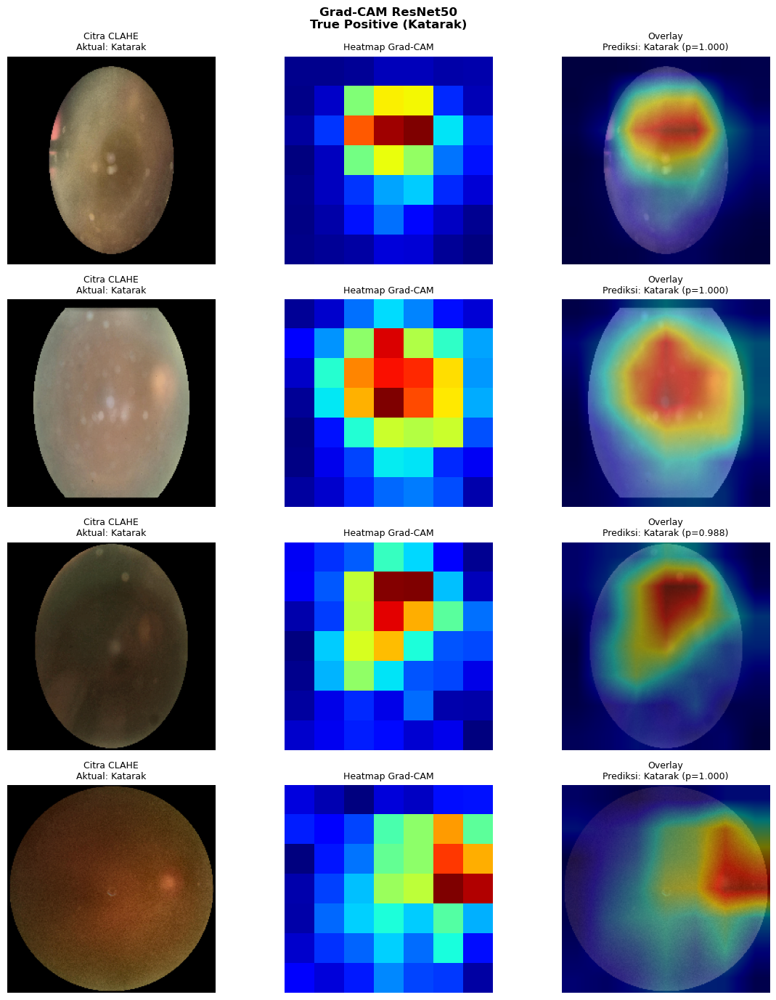
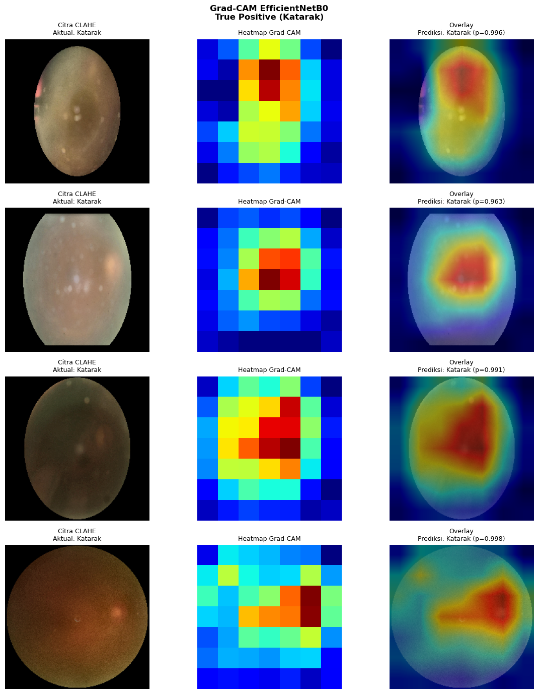

# Klasifikasi Katarak pada Citra Fundus: ResNet50 vs EfficientNet-B0

Repositori ini membandingkan dua model CNN, ResNet50 dan EfficientNet-B0, untuk mengklasifikasikan citra fundus menjadi **Normal** atau **Katarak**. Data berasal dari ODIR-5K. Pipeline memakai CLAHE dengan mask fundus untuk preprocessing dan Grad-CAM untuk melihat area yang memengaruhi prediksi.

Proyek ini berasal dari skripsi S1 Teknik Informatika. Hasilnya untuk keperluan penelitian. Model ini bukan alat diagnosis.

## Ringkasan

- **Data:** 3.081 citra mata (313 katarak, 2.768 normal) setelah seleksi dari 3.500 pasien ODIR-5K.
- **Preprocessing:** resize 224 x 224, mask fundus, CLAHE pada kanal L (clip limit 2,0, tile 8 x 8).
- **Split:** 70/15/15 per pasien, dilakukan sebelum balancing. Val dan test mempertahankan rasio kelas asli.
- **Balancing:** oversampling katarak 3 kali lipat dan flip acak, hanya pada data latih.
- **Training:** dua fase. Fase 1 melatih head dengan backbone beku. Fase 2 melatih 30 layer terakhir backbone.
- **Evaluasi:** threshold dipilih dari val set, lalu metrik dihitung pada test set.

## Dataset dan seleksi data

ODIR-5K berisi citra fundus kiri dan kanan untuk tiap pasien. Anotasi `data.xlsx` memuat 3.500 pasien. Kode mengubah tiap pasien menjadi dua baris mata, lalu menerapkan aturan berikut.

| Kondisi | Perlakuan |
|---|---|
| Keyword mengandung `cataract` | Label 1 (Katarak) |
| Keyword persis `normal fundus` | Label 0 (Normal) |
| Penyakit lain, `lens dust` tanpa `cataract`, keyword campuran, atau kosong | Dikeluarkan (3.871 mata) |
| Mata normal milik pasien katarak | Dikeluarkan (48 mata) |

Hasil split per pasien:

| Split | Total | Katarak | Normal | Rasio Normal : Katarak |
|---|---:|---:|---:|---:|
| Train | 2.153 | 221 | 1.932 | 1 : 8,74 |
| Val | 466 | 47 | 419 | 1 : 8,91 |
| Test | 462 | 45 | 417 | 1 : 9,27 |

Setelah oversampling, data latih berisi 2.595 citra (663 katarak, 1.932 normal, rasio 1 : 2,91).



## Preprocessing CLAHE

CLAHE bekerja pada kanal L ruang warna Lab. Mask fundus menjaga piksel hitam di tepi citra agar tidak ikut dihitung. Background diisi sementara dengan median L area fundus, lalu dikembalikan ke hitam.



## Arsitektur dan training

| Komponen | Pengaturan |
|---|---|
| Backbone | ResNet50 atau EfficientNet-B0, bobot ImageNet |
| Head | GlobalAveragePooling, Dropout 0,4, Dense(1, sigmoid, L2 1e-4) |
| Loss | Binary crossentropy |
| Fase 1 | Backbone beku, LR 1e-4, maksimal 15 epoch |
| Fase 2 | 30 layer terakhir backbone dilatih, LR 1e-5, maksimal 25 epoch |
| Callback | Early stopping dan checkpoint memantau `val_auc` (patience 12) |
| Normalisasi input | ResNet50: `preprocess_input` mode caffe. EfficientNet-B0: di dalam backbone |

Semua nilai ada di [`src/config.py`](src/config.py).

## Hasil

Metrik pada test set (462 citra, 45 di antaranya katarak). Threshold dipilih dari val set dengan kriteria F1 tertinggi.

| Model | Threshold | Accuracy | Precision | Recall | Specificity | F1 | AUC-ROC | TP | TN | FP | FN |
|---|---:|---:|---:|---:|---:|---:|---:|---:|---:|---:|---:|
| ResNet50 | 0,87 | 0,9784 | 0,9070 | 0,8667 | 0,9904 | 0,8864 | 0,9878 | 39 | 413 | 4 | 6 |
| EfficientNet-B0 | 0,79 | 0,9784 | 0,9070 | 0,8667 | 0,9904 | 0,8864 | 0,9894 | 39 | 413 | 4 | 6 |

Angka ini berasal dari satu run per model. File CSV ada di [`results/metrics_comparison.csv`](results/metrics_comparison.csv).

Hal yang terlihat dari tabel:

- Pada threshold masing-masing, kedua model menghasilkan confusion matrix yang sama. Perbedaannya ada di AUC-ROC (0,9894 untuk EfficientNet-B0, 0,9878 untuk ResNet50) dan di threshold.
- Recall 0,8667 berarti 6 dari 45 citra katarak terlewat oleh kedua model.

Perbandingan train dan validasi pada epoch terakhir fase 2:

| Model | Acc train | Acc val | Loss train | Loss val | AUC train | AUC val |
|---|---:|---:|---:|---:|---:|---:|
| ResNet50 | 1,0000 | 0,9614 | 0,0015 | 0,1118 | 1,0000 | 0,9960 |
| EfficientNet-B0 | 0,9715 | 0,9807 | 0,0759 | 0,0570 | 0,9962 | 0,9975 |

Pada run ini, ResNet50 menunjukkan jarak train-validasi yang lebih besar, terutama pada loss (0,0015 vs 0,1118). Early stopping menghentikan ResNet50 di epoch 22 fase 2 dan mengembalikan bobot epoch 10. EfficientNet-B0 menjalankan 25 epoch penuh, dengan bobot terbaik di epoch 20, dan tidak menunjukkan jarak itu. Tabel memakai epoch terakhir, bukan epoch terbaik.

| ResNet50 | EfficientNet-B0 |
|---|---|
|  |  |
|  |  |

## Grad-CAM

Grad-CAM memakai layer konvolusi terakhir: `conv5_block3_out` (ResNet50) dan `top_conv` (EfficientNet-B0). Feature map berukuran 7 x 7, lalu diperbesar ke 224 x 224. Heatmap menunjukkan wilayah kasar, bukan batas lesi.

| ResNet50 (True Positive) | EfficientNet-B0 (True Positive) |
|---|---|
|  |  |

Gambar True Negative dan False Negative ada di folder [`images/gradcam/`](images/gradcam/).

## Struktur repositori

```
klasifikasi-katarak-fundus/
├── README.md
├── requirements.txt
├── .gitignore
├── notebooks/
│   ├── 01_eda_dan_preprocessing.ipynb          seleksi data, EDA, split, CLAHE, cache
│   ├── 02_training_resnet50_efficientnet.ipynb training dua fase untuk kedua model
│   └── 03_evaluasi_dan_gradcam.ipynb           threshold, metrik, perbandingan, Grad-CAM
├── src/
│   ├── config.py          path dan hyperparameter
│   ├── data.py            seleksi data level mata dan split per pasien
│   ├── preprocessing.py   mask fundus, CLAHE, cache citra
│   ├── models.py          ResNet50 dan EfficientNet-B0 + head
│   ├── training.py        oversampling, augmentasi, training dua fase
│   ├── evaluation.py      pemilihan threshold dan metrik
│   ├── gradcam.py         Grad-CAM
│   ├── visualization.py   fungsi plot
│   └── utils.py           set seed
├── images/                gambar untuk README
├── results/               metrik, split, dan riwayat training (CSV)
├── data/                  dataset dan cache (tidak di-commit), lihat data/README.md
└── models/                bobot model (tidak di-commit)
```

## Cara menjalankan

```bash
git clone https://github.com/winntzy/klasifikasi-katarak-fundus.git
cd klasifikasi-katarak-fundus

python -m venv .venv
source .venv/bin/activate        # Windows: .venv\Scripts\activate
pip install -r requirements.txt
```

Letakkan dataset ODIR-5K di `data/ODIR-5K/` atau atur `ODIR_DATASET_PATH`. Detailnya ada di [`data/README.md`](data/README.md).

Jalankan notebook secara berurutan dengan `jupyter lab`:

1. `01_eda_dan_preprocessing.ipynb`
2. `02_training_resnet50_efficientnet.ipynb`
3. `03_evaluasi_dan_gradcam.ipynb`

Catatan:

- Notebook 02 membutuhkan waktu lama di CPU. Pada run di repositori ini (CPU, tanpa GPU), fase 1 memakan sekitar 73 detik per epoch untuk ResNet50 dan 34 detik untuk EfficientNet-B0.
- Array latih per model memakai sekitar 2,5 GB RAM, di luar memori TensorFlow.
- Bobot model dan cache citra disimpan di folder yang tidak masuk Git.

## Reproduksibilitas

- Seed tetap 42, dan split per pasien selalu menghasilkan pembagian yang sama.
- Training di TensorFlow memakai operasi yang tidak sepenuhnya deterministik. Angka hasil run ulang dapat berbeda tipis dari tabel di atas.
- Tabel hasil di README berasal dari run ketiga notebook di repositori ini (TensorFlow 2.21.0, CPU). Run sebelumnya dengan notebook asli memberi akurasi 0,9805 dan AUC-ROC 0,9836 untuk ResNet50, serta AUC-ROC 0,9902 untuk EfficientNet-B0. Selisih antar run ini menunjukkan variasi yang perlu dibaca bersama angka di tabel.
- Notebook 03 menimpa `results/metrics_comparison.csv` dengan hasil run Anda.

## Keterbatasan

- Test set memuat 45 citra katarak. Satu citra mengubah recall sekitar 2,2 poin persentase.
- Hasil berasal dari satu split dan satu run per model, tanpa interval kepercayaan.
- Data hanya berasal dari ODIR-5K. Penelitian ini belum menguji data dari sumber lain.
- Label berasal dari diagnostic keyword pada dataset, bukan dari penilaian ulang oleh dokter mata.
- Seleksi data mengeluarkan mata dengan penyakit lain. Model tidak dilatih untuk membedakan katarak dari penyakit mata lain.

## Referensi

- ODIR-5K: Peking University International Competition on Ocular Disease Intelligent Recognition (ODIR-2019).
- He, K., Zhang, X., Ren, S., Sun, J. (2016). Deep Residual Learning for Image Recognition. CVPR.
- Tan, M., Le, Q. (2019). EfficientNet: Rethinking Model Scaling for Convolutional Neural Networks. ICML.
- Selvaraju, R. R. et al. (2017). Grad-CAM: Visual Explanations from Deep Networks via Gradient-Based Localization. ICCV.
- Zuiderveld, K. (1994). Contrast Limited Adaptive Histogram Equalization. Graphics Gems IV.

## Lisensi

Kode dalam repositori ini dirilis di bawah lisensi MIT. Lihat berkas [`LICENSE`](LICENSE).
Dataset ODIR-5K tidak termasuk dalam lisensi ini dan memiliki ketentuan penggunaan sendiri
dari penyelenggara aslinya. Proyek ini bukan alat diagnosis medis.
